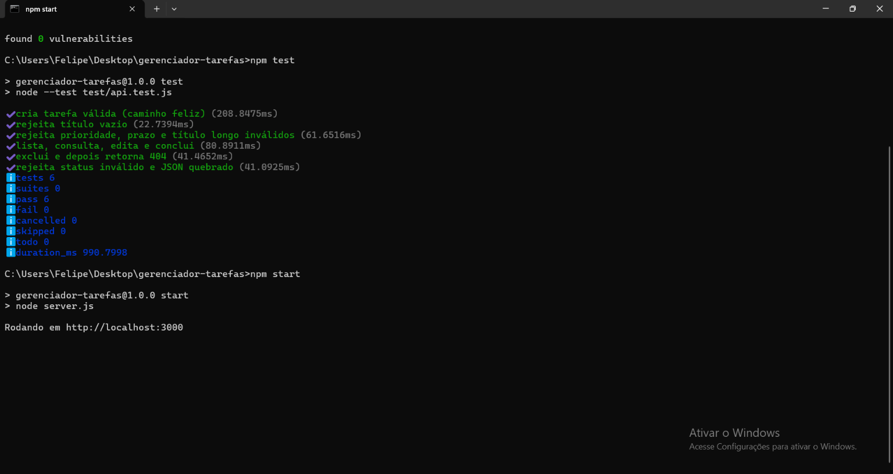
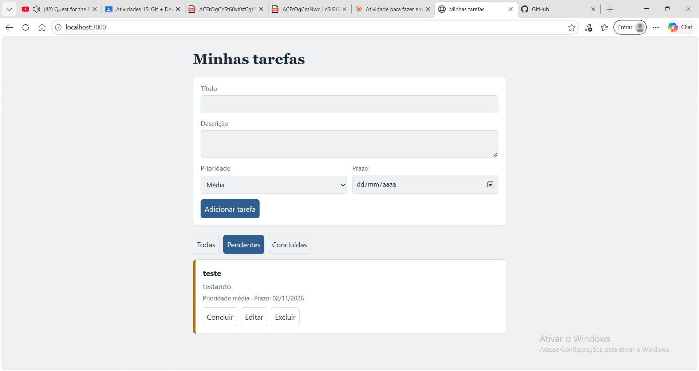
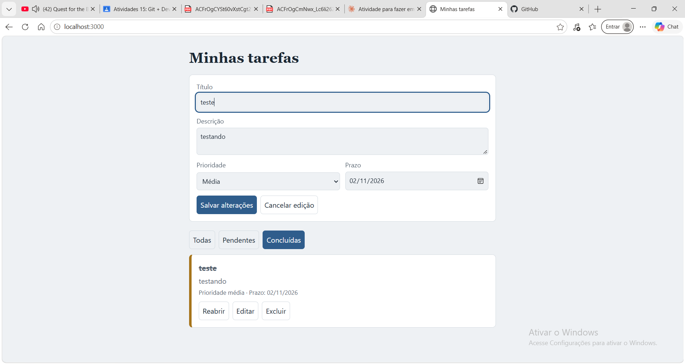
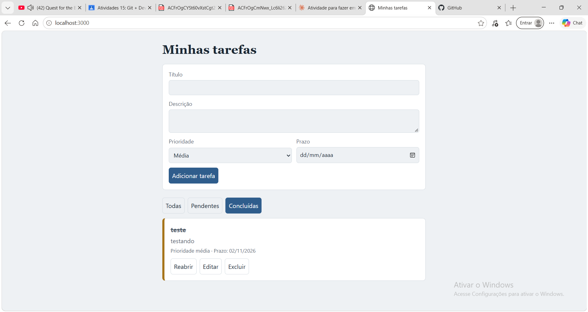
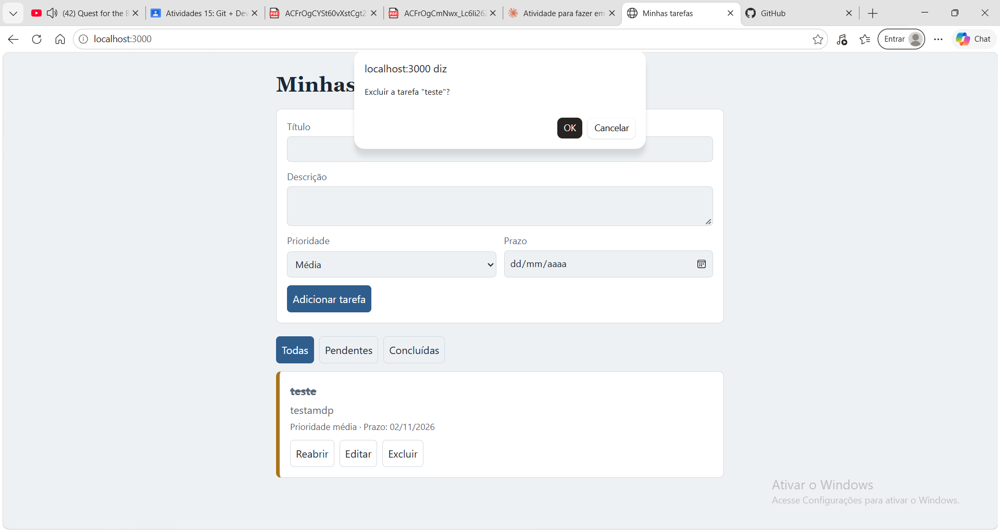
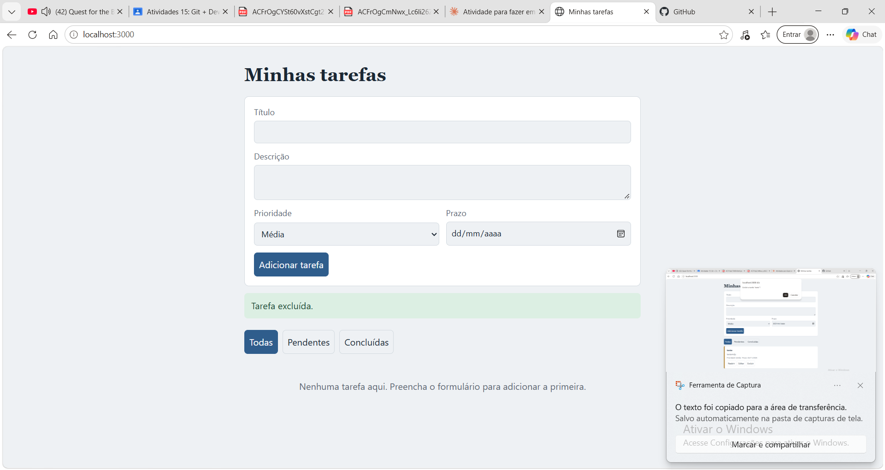
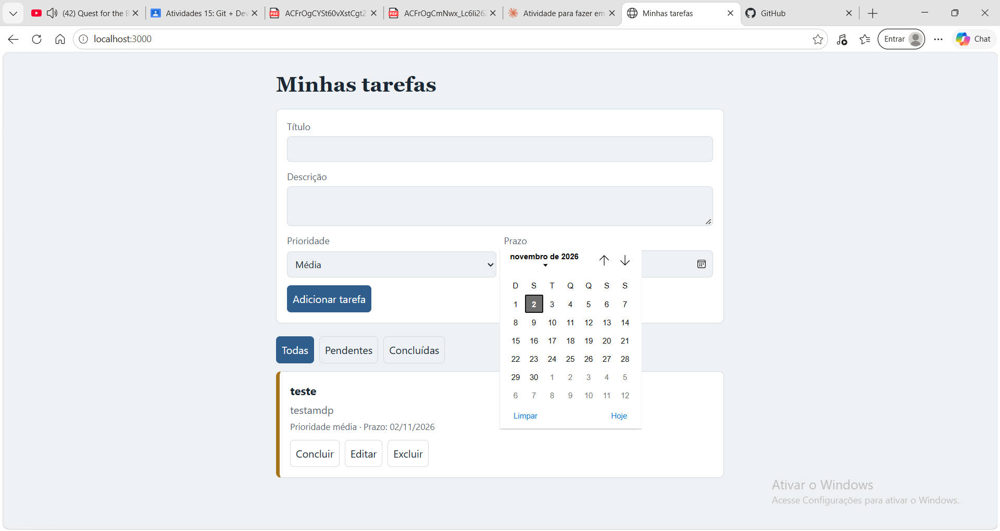
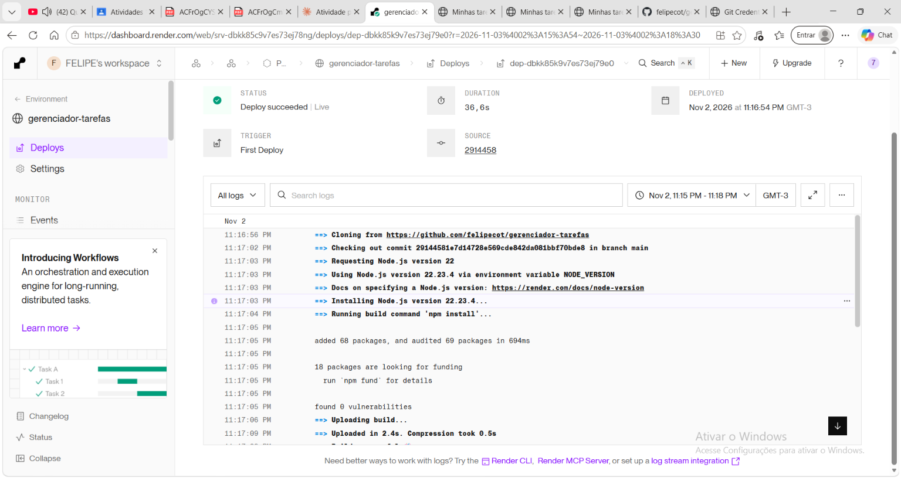

# Gerenciador de Tarefas

**Aluno:** Felipe Gustavo — RA 72301406  
**Professor:** Alexandre Sauer  
**Repositório:** https://github.com/felipecot/gerenciador-tarefas

Sistema web simples para cadastrar, consultar, editar, concluir e excluir tarefas (CRUD), desenvolvido com apoio de IA.

**🔗 Sistema publicado:** https://gerenciador-tarefas-shhx.onrender.com/

**Ferramenta de IA utilizada:** Claude (Anthropic)

## Funcionalidades
- Cadastrar tarefa com título, descrição, prioridade (baixa/média/alta) e prazo
- Listar, filtrar (todas/pendentes/concluídas), editar, concluir/reabrir e excluir
- Validação no servidor (título obrigatório até 100 caracteres, prioridade/status/prazo válidos)
- Mensagens de sucesso e erro; layout responsivo (computador e celular)

## Tecnologias
Node.js (22.13 ou superior), Express, SQLite (módulo nativo `node:sqlite`), HTML/CSS/JavaScript puro.
**Persistência:** SQLite foi escolhido por ser um arquivo simples, sem servidor separado e sem custo. Em hospedagem gratuita com disco efêmero (ex.: Render Free), os dados podem ser apagados ao reiniciar; para dados importantes use disco persistente ou banco gerenciado.

## Como executar
```bash
npm install
npm start          # http://localhost:3000
```
Copie `.env.example` para `.env` se quiser mudar `PORT` ou `DB_PATH` (não há segredos).

## Testes
```bash
npm test
```
Os testes chamam a API de verdade, com banco SQLite **em memória** (separado do banco real). Cobrem: caminho feliz, campos inválidos, edição, filtro, exclusão, 404 e JSON malformado.

## API
`GET/POST /api/tarefas` · `GET/PUT/DELETE /api/tarefas/:id` · `GET /api/tarefas?status=pendente|concluida`

## Resultados dos prompts de auditoria
Relatório completo em [AUDITORIA.md](AUDITORIA.md).

| Prompt | Resultado | Decisão |
|--------|-----------|---------|
| 4 — Auditoria completa | 5 principais riscos: sem login, erro 500 em vez de 413, sem rate limit, SQLite efêmero, duplo clique | Corrigir 413 e duplo clique; documentar o resto |
| 1 — Segurança | Sem segredos, sem regras só no front, sem RLS (não usa Supabase); SQL parametrizado e tela sem XSS | Corrigido o 413 e desabilitado o botão no envio |
| 3 — Testes | De 6 para 11 testes, incluindo corpo grande, id inexistente e criação simultânea | Nenhum teste removido ou enfraquecido |
| 2 — Refatoração | Validação movida para `src/validacao.js` sem mudar comportamento | Testes passaram antes e depois |

## Evidências

| Captura | Descrição |
|---------|-----------|
|  | `npm test` na versão inicial (6 testes passando) |
|  | Tarefa cadastrada e listada |
|  | Edição de tarefa (botão "Salvar alterações") |
|  | Tarefa concluída (filtro "Concluídas") |
|  | Confirmação antes de excluir |
|  | Mensagem "Tarefa excluída." |
|  | Campo de prazo com calendário |
|  | Deploy no Render concluído (Live) |

## O que a IA fez, o que precisou corrigir e o que aprendi
**O que a IA produziu corretamente:** a estrutura do sistema (API com Express, banco SQLite, tela em HTML/CSS/JS), a validação no servidor, os testes automatizados e o relatório de auditoria.

**O que precisou ser corrigido:** a primeira versão usava a biblioteca `better-sqlite3`, que não instalou no meu Windows (Node 24, sem ferramentas de C++). Foi trocada pelo SQLite que já vem no Node (`node:sqlite`), e os testes voltaram a passar. A auditoria também achou que um corpo de requisição grande devolvia erro 500 em vez de 413 e que o duplo clique criava tarefas repetidas; os dois foram corrigidos.

**O que aprendi:** que a validação precisa ficar no servidor, porque o navegador pode ser alterado; que testes de integração devem usar um banco separado (em memória); que um teste que falha por bug real não deve ser apagado; e que uma refatoração segura muda a organização do código sem mudar o comportamento, com os testes rodando antes e depois. Também vi que o plano gratuito do Render pode apagar os dados do SQLite, e por isso isso está documentado.
